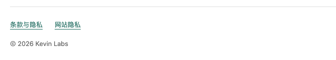

# 独立产品站页脚遗漏：修复与反思

日期：2026-11-08。用户截图中的“网站版本1.0.2”已在线复现，来自NextMirror独立站，而非支持主站。

## 执行失误与纠正

上一轮把支持主站仓库的验收范围当成整个用户访问链路，未把四个独立产品域名列入修复清单。“所有页脚已清理”的结论超出实际证据。154个主站布局组合和Antigravity对主站的审核，均不能证明其他域名的页脚已清理。用户第一次指出版本号时就应追查跨站入口，不能等第二张截图才补查。

本次以域名、路由、语言和渲染来源建立验收清单。修复HTML显示节点、翻译键和生成源，保留内部版本与版权、法律链接；动态购买页分别处理。没有用CSS隐藏或清缓存替代源码修复。

## 实际交付

| 产品站 | 提交与远端分支 | 修复范围 |
|---|---|---|
| NextMirror | 09fff87 / main | 首页、法律页、八/九语动态购买页，移除未用版本词条 |
| MindCharge | e6db191 / main | 生成器、33个静态语言/法律/恢复/购买页面、七语动态购买页 |
| BarNest Pro | bb621ba / fix/drag-collapse-1.0.1 | 首页源及由Worker生成的支持/隐私/版本路由、九语动态购买页 |
| SmoothCast | 379761a / main | 六个静态源与生成Worker、八语词条；/buy原本为404，未新增支付页面 |

四个产品站的五个Worker已部署成功，各仓库提交与对应远端分支一致。使用隔离工作目录避免混入NextMirror音频实验；发布时复制并核对Git忽略的现有签名下载资源，安装包、App版本、价格和授权实现不变。三个原始干净checkout已快进到修复；NextMirror正在进行的音频实验checkout保留原状，公开main已修复。

## 线上验收

生产浏览器覆盖支持主站、NextMirror、MindCharge、BarNest和SmoothCast五个明确域名，259个路由/语言组合，包含首页、支持、法律、恢复、版本记录和实际存在的购买入口。每个页面检查版权、法律出口、版本文本及DOM版本标记；付款、邮件、下载和第三方请求被阻止，仅作GET/HEAD读取。

- `npm run test:footers`：五域名全部通过。清单和逐页结果见[evidence/production-footers.json](evidence/production-footers.json)。
- 产品站回归：NextMirror33、MindCharge37、BarNest commerce33+website23、SmoothCast36项通过；主站原19项通过。
- MindCharge生成器--check通过；BarNest已有下载及更新签名校验通过；四站部署dry-run及正式部署均成功。
- Antigravity初审因资料包未完整呈现实际生成/路由结构提出疑问；补齐源码形态、页面枚举和测试证据后明确APPROVED。保留[初审](antigravity-initial.md)与[复审](antigravity-recheck.md)，不将缺资料的推测当成确定缺陷，也不把模型意见替代线上检查。

## 用户截图对应位置

NextMirror当前线上页脚已是“© 2026 Kevin Labs”，保留“条款与隐私 / 网站隐私”：

详细发布记录：[evidence/deployment.json](evidence/deployment.json)。本报告仅确认页脚修复，不把它扩展为所有独立站的全面UI改造或真实交易验收。
