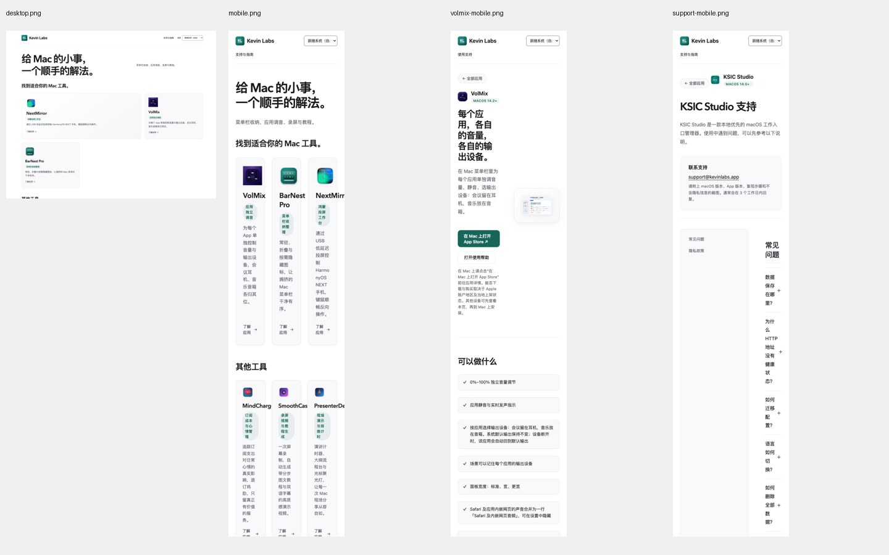

# Kevin Labs 网站 UI 系统审查与改造建议

审查日期：2026-11-08（北京时间）｜报告版本：1.0｜审查对象：线上网站 v2.2.6。

**结论：保留现有白底、黑灰文字、青绿强调色与真实产品图标。首先修复响应式和内容结构，再整理首页产品层级，最后做视觉精修。当前最影响使用的是布局回归，而不是配色不够漂亮。**

本报告按用户指定的 `~/shared-agent-skills/crap-ui-polisher/SKILL.md`，结合六步工作流、审查清单和设计令牌规范执行。所有改造方向均为建议，未实施生产页面修改。

## 1. 证据与覆盖范围

- 线上入口：https://support.kevinlabs.app/index.html 。截图与尺寸测量来自真实 Chrome 页面。
- 本地源码基线：`2396ba49deb69eaebd3c03e7fea55102f36b4795`，审查时与远端 main 一致。
- 首页检查 320、390、768、850、851、1024、1440 CSS px，共七档宽度。
- 另外十页检查 390 与 1440px，共计 **11 个页面、27 个页面/视口组合**。见 [尺寸证据](evidence/viewport-matrix.json)。矩阵使用同源 iframe 测量；首页、VolMix、支持页等另以顶层页面截图复核。
- 覆盖首页、支持目录、VolMix、NetDoctor、PresenterDeck、KSIC Studio、VolMix 支持、BarNest 支持、KSIC 支持、网站隐私、KSIC 隐私。
- 首页检查八种语言和“跟随系统”的渲染，法语模式跨页持久化已复核；不是八语全文翻译审校。
- NextMirror、BarNest Pro、SmoothCast 独立站仅抽查入口、导航和语言参数，不代表对三个独立站完成全量审查。
- 检查系统深色偏好、首个 Tab 焦点、FAQ 展开、加载图像及当前首页控制台。未进行真实购买、发信、下载或安装。
- 现有 `node --test tests/*.test.mjs`：**13/13 通过**，但仍复现布局缺陷；这些测试主要检查结构、文本与链接，不足以代替浏览器验收。
- 本次未执行完整读屏、Safari/iOS 真机、自动化全站无障碍扫描、网络性能压测或转化率分析。没有证据支持“全面符合 WCAG”或“改造后一定提升转化率”。



证据标记：**实测**指线上浏览器测量/截图；**源码**指代码支持、尚未完整交互复现；**建议**指设计判断。P0 为阻断主要阅读/浏览，应首先修复；P1 为明显影响任务完成和理解；P2 为品质与维护优化。此优先级不代表安全事故等级。

## 2. 必须先修的布局问题

| 编号 / 级别 | 发现与证据 | 用户影响 | 改造要求与验收 |
|---|---|---|---|
| R01 / P0 | **实测**：390px 首页内容宽 342px，主产品仍为三个 98px 列；其他工具约 101px/列。320px 时主产品约 75px/列。 | 中文逐字折行，产品名越界，入口难以识别。 | 手机改为一列；中等宽度按卡片可用宽度决定两列；宽屏三列。320/390/430px 均无裁切、内容不靠横滑才能看全。 |
| R02 / P0 | **实测**：390px 的 VolMix Hero 仍为 `140.6px + 48px gap + 153.4px` 两列。 | 标题竖向堆叠，说明难读，截图被缩成缩略图。 | 手机按“产品身份→用途→行动→必要限制→截图”单列展示；截图独占内容宽度，并可查看大图。 |
| R03 / P0 | **实测**：支持与隐私阅读布局为 `230px + 56px gap + 56px` 正文。 | 目录占据绝大部分屏宽，正文近乎竖排，支持流程实际不可用。 | 手机取消侧栏，目录放在正文上方，使用轻量展开目录或普通锚点；正文使用完整内容宽度。 |
| R04 / P1 | **实测**：桌面 NextMirror 跨两列，VolMix 占一列；BarNest 独占下一行，下一行约 2/3 空置。主产品区域高约 644px。 | 大片留白没有对应内容，主产品层级像未排完的网格。 | 默认恢复三张同规格卡片。若确需主推 NextMirror，做独立完整特色区，其他产品另成整齐一行，排序须经过业务判断。 |
| R05 / P1 | **实测/源码**：PresenterDeck `.text-product-hero` 只有一个内容子节点，却被覆盖成两列；桌面右侧空置，移动端内容只有约 141px。 | 本应阅读的支持内容挤在半栏，长文页尤其严重。 | 明确区分“有截图产品 Hero”“纯文字支持页”；单子节点模板不得继承双列布局。 |
| R06 / P1 | **实测**：850→851px，主产品布局从一行变两行，区域高由约335px跳至694px，内容宽从802px降至755px。 | 小幅改变窗口宽度会让页面大幅跳变。 | 在断点两侧各测一档；容器边距和卡片跨列策略共同设计，避免多个断点叠加。 |
| R07 / P1 | **实测/源码**：桌面视觉顺序为 NextMirror→VolMix→BarNest，DOM/键盘顺序为 VolMix→BarNest→NextMirror。手机页头也用 order 改变导航与语言的顺序。 | Tab 焦点在屏幕上跳来跳去，视觉与辅助技术体验不一致。 | 以 DOM 表达真实阅读顺序；不靠 CSS order 调整业务优先级；无需使用正 tabindex 补救。 |
| R08 / P1 | **实测/源码**：根元素 `overflow-x:clip`，首页部分内容右边缘超过视口。 | 页面“没有横向滚动条”，但内容已经丢失，简单溢出测试会误报通过。 | 检查可见元素边界、实际文字换行与容器宽度；修布局根因，不能依赖裁切掩盖。 |

源头集中在 `assets/monochrome.css`：第68/86行的后置三列规则、第114行双列 Hero、第157行附近的阅读双列覆盖了前面已有的窄屏规则。不是缺少 viewport 标签，也不是缺少所有响应式代码，而是后加样式破坏了既有约束。

原始截图：[首页桌面](evidence/desktop.png)、[首页手机](evidence/mobile.png)、[VolMix 手机](evidence/volmix-mobile.png)、[支持页手机](evidence/support-mobile.png)。

## 3. 首页应怎样重组

首页同时服务两类人：新访客寻找应用；已有用户寻找支持。建议以“产品目录”为主体，支持入口在页头直接可达。首页不必增加复杂搜索、筛选器、轮播或标签导航，八个产品目前可以直接浏览。

**建议结构：**

```text
Kevin Labs                         全部应用  支持与指南  语言

Mac 工具
三张同规格主产品卡片
其余产品以同一字段规范排列

BarNest 商店版支持（普通辅助行，保留指南与隐私出口）

常见问题（购买与授权、权限、兼容性、隐私）

联系支持                    邮件入口 + 可复制地址

隐私及必要法律链接                        版本信息入口
```

| 编号 / 级别 | 当前问题与判断 | 具体改造 |
|---|---|---|
| H01 / P1 | **实测/建议**：“给 Mac 的小事，一个顺手的解法。”与“找到适合你的 Mac 工具。”连续承担引导作用；前者字号很大，后者马上再提示选工具。 | 首页保留一个直接说明内容的标题，例如“Mac 工具”；删去重复引导语，产品尽早进入视野。品牌表达可通过产品和视觉一致性传达。 |
| H02 / P1 | **实测/建议**：右侧说明与大标题隔开，且概括仅列菜单栏、调音、录屏，没有覆盖投屏等全部类型。 | 若需要副标题，放到标题下方并限制一行至两行；无需把全部品类重新列举一遍。 |
| H03 / P1 | **建议**：主产品与“其他工具”表达了业务层级，但当前排位不能解释为销量或推荐排名。 | 保留主次分组时记录选品依据；不要因为某款刚发布就用 CSS 跨列强行抬高。当前顺序与旧 design.md 也存在漂移，不能照旧文件擅自恢复产品名单。 |
| H04 / P1 | **实测/建议**：每张卡片同时有产品名、绿色胶囊用途、说明、了解应用；短用途被弱化为12px标签。 | 产品名→用途短句→一条差异说明→查看入口。用途是选品依据，改为正常文字，取消常态胶囊与英文全大写。 |
| H05 / P1 | **实测/建议**：BarNest 商店版支持以虚线卡片占据一个产品格，视觉像一个第六款工具或占位项。 | 从产品网格移到分组后的辅助行，明确“BarNest（Mac App Store 版）”；指南和隐私保留，勿因减法删掉历史用户出口。 |
| H06 / P1 | **建议**：全部卡片“了解应用”合理，但用户进入后面对商店购买与官网试用两种分发方式，预期不清。 | 对确有帮助的分发差异用一条简短元信息表达，或在详情页首个行动旁明确；价格、状态必须来自当前产品配置，不能手工猜测。 |
| H07 / P2 | **实测/建议**：主产品64px图标、其他产品36px图标可以体现层级，但图标源文件留白不同，视觉大小并不完全相同。 | 规范图标容器与光学大小；保留真实图标原色，不统一染成青绿；图标不再额外套多重阴影。 |
| H08 / P2 | **实测/建议**：大卡片尺寸提高，却没有增加截图或更有用的信息；同时每块都有边框、底色、阴影。 | 列表同类对象采用一致表面；卡片只保留微底色或轻边框，浮层再用明显投影；整卡点击和焦点反馈保留。 |

**排版建议而非固定设备规则：** 320–600px 一列，601–1000px 按内容使用两列，宽屏三列；实际断点以德语、法语长词与中文说明都能正常阅读为准。主产品不在手机上横向轮播隐藏。

## 4. 产品页与支持体系

| 编号 / 级别 | 当前问题与判断 | 具体改造与验收 |
|---|---|---|
| D01 / P1 | **实测**：VolMix 首屏用途、行动与截图已经具备；PresenterDeck 从首页“了解应用”进入却是“支持中心”。 | 建立页面角色：产品介绍、支持、隐私分别使用对应模板。若暂时没有产品介绍页，目录入口就明确“查看支持”，避免承诺与落地内容不符。 |
| D02 / P1 | **实测**：VolMix 主按钮直接使用 `macappstores://`，手机访问者没有同等明显的网页商店入口。 | 提供 HTTPS 商店详情链接作为稳定可访问路径；Mac 上可保留“在 App Store 打开”。不要要求非 Mac 用户尝试系统协议后才知道不支持。未实际触发协议，因此这里不是断言所有浏览器都会失败。 |
| D03 / P1 | **实测/建议**：VolMix 的七条能力全部转为独立卡片，从一句音量调节到较长输出路由说明都用同等权重；部分同行顶部错位。 | 聚合为三组核心能力：独立调音、输出路由、场景。较细的宽度设置和合并音源说明放入普通列表或帮助。清除全局 `li+li` 给 grid 项带来的额外上边距，统一卡片内部对齐。 |
| D04 / P1 | **实测/建议**：VolMix 截图内含标题，外部也有大标题；手机时截图信息几乎无法读。 | 截图用于展示操作结果，文字标题讲用途；保留图内真实状态，必要时裁切关键面板。提供无障碍可操作的放大入口，不依赖 hover 放大。 |
| D05 / P1 | **实测/建议**：“使用前了解”包含权限、兼容限制和100%音量上限，这些是关键决策信息。 | 保留并精简，不隐藏成小字或完全折叠；购买前能看到平台要求、必要权限、已知限制。不能为了页面干净删掉限制。 |
| D06 / P1 | **实测**：支持目录列出八款应用，但大多数行只给产品名；直接邮箱位于目录后。 | 保留产品图标和名称，必要时补一条用途或支持类型，方便忘记产品名的用户识别；各产品到对应支持入口，点击后不重新选产品。 |
| D07 / P2 | **实测/建议**：阅读目录为 sticky，但 grid 默认拉伸使目录容器高度接近全文。 | 桌面目录 `align-self:start`，长度由内容决定；长目录有视口内滚动边界，当前章节高亮可渐进增强；手机恢复自然文档流。 |
| D08 / P2 | **实测/建议**：支持页正文桌面可达946px，中文 FAQ/隐私长行阅读负担较大。 | 英文阅读宽度约60–75ch，中文按实际字数调整；正文16px、1.6–1.8行高。正文不套密集数据表格的Compact规则。 |
| D09 / P2 | **建议**：视频入口与阅读正文处于同等大容器层级，低信息密度区域拉长滚动。 | 用缩略图、时长、字幕语言、更新日期帮助决定是否播放；这些信息只有核实后才展示。保留“画面可能较早”的必要边界，避免伪装当前版本。 |

## 5. 反馈、语言与无障碍

| 编号 / 级别 | 发现与证据 | 改造要求 |
|---|---|---|
| I01 / P1 | **源码**：点击任意 mailto 会同时尝试复制邮箱并显示 Toast。用户只想发邮件时，额外复制不符合操作名称。 | “发邮件”“复制邮箱”成为两个清晰动作；失败时说明实际失败项；保留网页版邮箱作为替代入口。无需增加复杂工单系统。 |
| I02 / P1 | **源码**：Toast 只有中文/英文分支，其他六种语言落入英文；邮件预填模板也有回退英文。 | 将反馈、错误、操作名和邮件模板纳入八语词条；国际化验收不只检查首屏标题。 |
| I03 / P1 | **源码**：Toast 创建时没有 status/live 语义；隐藏后没有清除内部链接的键盘可达性。 | 成功反馈用 `role=status`/适当 live 区，保留焦点；隐藏时移除节点或使链接不可交互。失败信息必须允许再次读取，不让用户追赶短暂提示。 |
| I04 / P1 | **实测/源码**：从德语首页进入 NextMirror 的链接没有 lang 参数；URL指定语言仅作用于当前页，点击内部无参数链接可能回到系统偏好。 | 在站内与跨域链接统一携带显式模式或语言，尊重各产品支持列表；区分“手动语言”和“跟随系统”，不要将自动模式永久固化为当前中文。手动选择法语的同源持久化已验证可用，应保留。 |
| I05 / P2 | **源码**：MindCharge 跨站语言映射未列 ko/pt，映射回退英文。 | 核对目标实际支持的语言；若不支持，应明确回退，并避免让用户误以为已沿用韩语/葡语。此处不是断言目标站必须支持主站全部语言。 |
| I06 / P1 | **实测**：390px页头语言选择35px高，导航32px高，联系主按钮40px高，旧版支持链接约21px高。 | 主要触控控件采用44px高的项目设计目标，可通过内边距扩充热区；不要给整张可点卡片中的文字入口另做重复焦点。 |
| I07 / P2 | **实测**：手机语言选择器固定112px，“跟随系统（自动）”被截短。 | 用可理解的短标签“自动”配可访问名称，或给选择器足够宽度；德语和法语也必须检查，不能只看中文。 |
| I08 / P2 | **实测/建议**：FAQ语义和展开状态已有基础；首页将跨产品购买、VolMix权限、未来适配承诺混在同组。 | 首页保留通用购买、授权与隐私问题；VolMix权限放对应产品帮助。未来兼容性使用可验证的支持范围，不用无法保证的永久承诺增加“安心感”。 |
| I09 / P2 | **实测/源码**：版本 v2.2.6 存在于HTML，却被 `.site-version{display:none!important}` 全站隐藏，页脚留下末尾分隔符。 | 版本信息可放低优先级关于/站点信息入口，保持用户可查；删除悬空分隔符。网站版本和产品版本分别维护。 |
| I10 / P2 | **实测**：系统深色偏好下仍是白底，根 `color-scheme:light`。 | 当前白色品牌并非缺陷，暂不为改造范围增加深色模式；同步整理与实际不一致的元声明。后续若支持深色，完整验收图片底色、表单与状态，而非只换背景。 |
| I11 / P2 | **源码/建议**：产品图标多为装饰性空alt，邻近已有产品名，这是合理的；品牌logo alt又重复品牌名，截图常仅为“用途对比图”。 | 品牌图标可避免重复朗读；关键截图提供有信息的替代描述或邻近解释，SVG箭头和勾选装饰不进入可访问名称。 |

**不要误报标准：**44×44px 是本项目采用的触控设计目标，并非所有控件的 WCAG 2.2 AA硬门槛。AA目标尺寸条款为24×24 CSS px，并有间距、行内链接等例外；需逐项判断，不能见到21px高链接就直接判定违法或不合规。参见 [W3C 目标尺寸说明](https://www.w3.org/WAI/WCAG22/Understanding/target-size-minimum.html)。

正文普通文字最低4.5:1，大字最低3:1，依据 [W3C 文字对比度说明](https://www.w3.org/WAI/WCAG22/Understanding/contrast-minimum.html)。当前青绿与灰字从观察上并非首要矛盾，仍须计算各真实前背景组合，不能据截图宣告全站通过。布局还应满足 [320 CSS px 重排要求](https://www.w3.org/WAI/WCAG22/Understanding/reflow.html)。视觉与程序顺序应结合内容意义判断，见 [W3C 有意义的顺序](https://www.w3.org/WAI/WCAG22/Understanding/meaningful-sequence.html)；本报告将独立产品卡片排序差异列为体验问题，没有据此直接判定该条款失败。

## 6. 视觉系统：收敛，而非另起一套风格

| 维度 | 当前判断 | 建议规范 |
|---|---|---|
| 亲密性 | 产品名、用途、描述已有基本归组；用途胶囊和装饰卡片制造额外视觉单位。 | 名称到用途8px，用途到描述8–12px；说明到行动16–20px；组内关系先于容器装饰。 |
| 对齐 | 页面主左边缘基本一致，应保留；grid中的列表项附加margin造成局部不齐。 | 容器统一左边缘；卡片名称、说明与行动使用统一内部起点；多行时行动自然落底，避免固定高度裁切。 |
| 重复 | 共享CSS已有变量，却在多次追加规则中重复定义按钮、卡片、圆角、阴影。 | 建立明确组件和变体，清理相互覆盖的旧定义；每个组件只有一个可追踪的响应式责任区。 |
| 对比 | 青绿强调克制；字号从11px徽章到68px口号跨度很大，核心用途反而偏小。 | 让产品用途与操作可读性优先。首页标题40–52px，手机30–36px；区块24–28px；产品名22–26px；正文16px；辅助13–14px。数值为建议，需按各语种调校。 |
| 留白 | 桌面主网格空洞、页尾多层margin叠加，并非有意识地围绕内容留白。 | 模块32–48px，必要大区块48–64px；卡片内20–24px；先修空网格与双列空栏，再调间距。 |
| 材料 | 细边框、浅底、投影、渐变叠加覆盖多数元素，整体开始“容器比内容更突出”。 | 常态卡片尽量用一种主要分隔方式；减少空泛的渐变舞台；清晰焦点和hover有用，非交互截图不必悬浮响应。 |

建议保留的基础令牌：背景`#fff`、主文字`#1a1a1a`、辅助文字`#5c6068`、强调`#17665a`；具体可访问对比度以计算为准。间距限定4/8/12/16/24/32/48/64，圆角以控件6–8、卡片12、必要胶囊9999三类为主；字体保留系统无衬线与现有可用后备。没有理由为这轮改造增加Web字体依赖。

“主行动唯一”应按任务理解：产品页有一个主要下载/商店按钮；首页是目录，八张同类卡片可以平等可点，不必人为把其中一张刷成高饱和主CTA。技能中后台用到的行内编辑、抽屉、保存中、删除撤销与高危弹窗，不适用于目前没有这些操作的静态支持站，不应机械添加。

## 7. 工程与信息维护

| 编号 / 级别 | 证据与风险 | 建议 |
|---|---|---|
| E01 / P1 | **源码**：`site.css`加`monochrome.css`多次后置覆盖，同名规则职责交错；已有响应式规则被后加桌面样式覆盖。 | 小步整理组件样式；基础→布局→组件→断点或清晰cascade层级。先做截图基线，再去重，禁止继续在文件末尾追加“再覆盖一次”。 |
| E02 / P1 | **源码/实测**：13项测试通过却允许正文剩56px；“three featured peers”只检查DOM，没检查实际同规格。 | 增加浏览器层的关键不变量和少量截图回归，直接检查卡片列数、正文宽度、可见内容边界与顺序。 |
| E03 / P1 | **源码**：`design.md`记录2.1.0及旧主产品名单；页面2.2.6；`assets/products.json`中VolMix限制写不支持应用输出路由，当前页面却明确支持；SmoothCast版本字段亦存在多来源。 | 梳理HTML、index.json、products.json谁是权威和谁在消费；未核实前不批量覆盖。统一产品能力、系统要求、渠道及版本来源，生成各语种页面或进行一致性校验。 |
| E04 / P2 | **源码**：八语整段HTML复制容易漏同步；反馈逻辑又另写中英两套。 | 可沿用静态站，不必重写SPA。将产品数据、翻译词条与模板拆分，构建时生成静态HTML，保持无脚本英文回退和既有显式链接。 |
| E05 / P2 | **实测/建议**：独立站有不同语言标签、导航及返回参数；SmoothCast品牌链接不带语言，返回全部应用则带。 | 共享品牌栏协议、返回全部应用、支持与语言传递规范；允许产品站有各自演示内容与购买步骤，不强行所有页面一个布局。 |
| E06 / P2 | **建议**：现有统计可观测访问、下载和购买点击，但无法由这次UI观察得出真实漏斗结论。 | 若后续评估改造效果，先定义产品详情、支持到达、下载/商店跳转的聚合指标；维护隐私声明，不为评审默认增加追踪或持久用户标识。 |

## 8. 按阶段实施，避免一轮改动牵连全部站点

**第一批：恢复可用性。** 处理R01–R08，修复共享样式顺序、手机单列、文档宽度、纯文字模板和桌面网格空洞；保留产品文案、渠道和功能。补充关键浏览器验收。该批是缺陷修复，应评估网站修订版本，报告本身不修改网站版本。

**第二批：整理首页与详情。** 单一首页标题、同规格产品卡、移出商店旧版支持、简化用途标签、厘清产品介绍和支持页职责、改善商店入口。产品分组可在效果图中比较，但不需要三套互不相关的品牌方案。

**第三批：完善一致性。** 收敛设计令牌与模板、补齐反馈语言、规范跨域语言、增强邮件入口和文档目录、恢复可查版本信息、更新维护文档。

建议每批独立提交、验证后发布；不要在同一批同时重做购买、后台统计和多个独立站。缺少需求时不增加搜索系统、登录、聊天机器人、复杂工单、深色模式或大型前端框架。

## 9. 改造验收清单

- [ ] **320/390/430px 首页**：产品单列、产品名完整、说明正常断行、无裁切；不能仅检查scrollWidth。
- [ ] **768/850/851/1024/1440px**：卡片网格无非预期空行；断点两侧高度变化合理；无仅含少量文字的巨型留白。
- [ ] **产品页**：手机Hero单列；截图可读/可放大；纯文字模板不保留空白图片列；必要限制、平台和渠道可见。
- [ ] **支持/隐私**：手机正文占满可用宽度、目录不挤正文；桌面目录不拉伸到全文高度；锚点有效。
- [ ] **语言**：八种语言加自动模式，正文/导航/反馈/错误一致；手动与自动选择跨页保持，跨域按支持能力正确传递；URL指定语言的后续导航有明确规则。
- [ ] **输入与焦点**：Tab顺序符合视觉动线；focus-visible明确；FAQ能用Enter/Space操作；无隐藏Toast链接获得焦点。
- [ ] **触控与重排**：主要控件44px目标；200%文字放大、320 CSS px重排可用；检查长语言和系统字号。
- [ ] **真实操作**：邮件入口、复制成功/失败、HTTPS商店与Mac系统入口、图片和视频失败反馈；购买只在授权测试环境验证。
- [ ] **可访问性**：计算真实颜色组合；检查图片替代文本和状态播报；再做读屏与自动扫描，勿将自动扫描当全部验收。
- [ ] **跨浏览器**：Chrome桌面、Safari桌面、iOS Safari真机；本次审查未完成这些额外平台验收。
- [ ] **回归与交付**：原13项测试、关键浏览器布局测试、资源版本哈希、站点版本、产品目标链接、跟随系统和无脚本回退均核查。
- [ ] **维护**：design.md、发布说明和产品数据一致；只有本任务改动进入提交；无关`.hallmark`目录不混入。

## 10. 六大设计思想的最终落点

1. **《简约至上》**：删重复口号、装饰标签和无意义卡片；组织产品与支持；保留历史支持和故障出口；不增加当前不需要的复杂搜索。
2. **《设计中的设计》**：留白围绕内容形成层级；修复空网格，减少材料叠加；目录与文档采用舒适阅读密度。
3. **《写给大家看的设计书》**：用亲密性组织卡片文字，用共同边缘对齐，用统一组件重复，用字号和行动对比建立层次。
4. **《Web界面设计》**：直接进入对应支持；清晰的整卡点击、焦点和图片查看；减少“了解应用”后再找帮助的折返。
5. **《瞬间之美》**：反馈表达真实动作，邮件和复制分开；权限、兼容限制提前可见；对失败提供可恢复出口。
6. **《UI设计黄金法则》**：手机重排、键盘顺序、触控热区、长语种和平台商店路径共同验收，不能仅凭一张桌面截图判断质量。

**这轮最有价值的成果，应是任何设备都能看清产品、找到正确入口，并且后续一次样式修改不会再破坏整类页面。**
